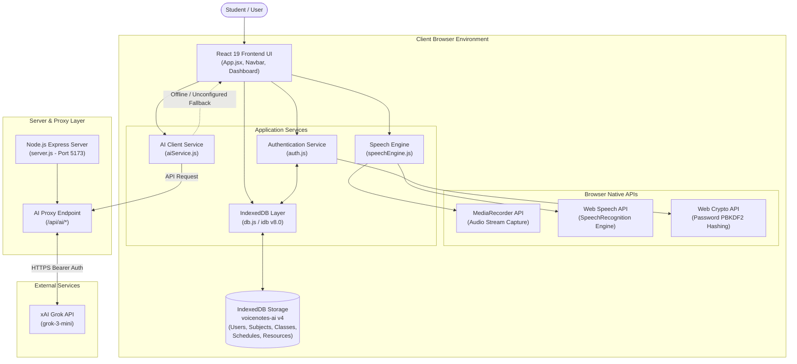

# System Architecture — LectureAI

This document describes the academic software architecture of the **LectureAI** platform.

---

## 1. High-Level Architecture Overview

**LectureAI** is structured as a client-side modern web application powered by React 19 and Vite 6, utilizing browser-native media and speech recognition APIs alongside a Node.js Express backend proxy for external AI requests.

---

## 2. Layered Architecture Description

### 2.1 User Interface Layer (Presentation)
- **Framework**: React 19 & Vite 6
- **Styling**: Modern CSS Custom Properties with dark navy/purple glassmorphism theme (`#0B0E14`, `#131827`, `#635BFF`).
- **Components**: View components corresponding to the 12 core modules (`AuthPage`, `Dashboard`, `LiveSession`, `NoteViewer`, `ResourcesPage`, `FlashcardViewerPage`, `Calendar`, `AIAssistantPage`, `ProgressPage`, `SettingsModal`, `Navbar`).

### 2.2 Application Services Layer (Logic & Controllers)
- **`auth.js`**: Manages user registration, login authentication, and active user session state.
- **`speechEngine.js`**: Wraps the browser's `SpeechRecognition` API, handling continuous listening, interim text events, and automatic restart on speech pauses.
- **`aiService.js`**: Dispatches requests for summarization, topic extraction, and question answering to the backend proxy, with intelligent rule-based local fallbacks.
- **`textProcessor.js`**: Extracts structured bullet notes and highlights key terms from live speech transcripts.

### 2.3 Browser Native API Layer
- **MediaRecorder API**: Records raw microphone audio input into `audio/webm` chunks during active live sessions.
- **Web Speech API**: Performs continuous client-side speech-to-text recognition in real-time.
- **Web Crypto API**: Generates PBKDF2 key hashes and salts for secure client-side password handling.

### 2.4 Data & Persistence Layer
- **IndexedDB (`idb` v8.0)**: Manages local object stores (`users`, `subjects`, `classes`, `schedules`, `resources`) ensuring 100% offline accessibility and persistent state across page reloads.

### 2.5 Server & External Proxy Layer
- **`server.js`**: Express backend proxy server that securely stores environment configuration (`GROK_API_KEY`), routes `/api/ai/*` endpoints, and serves built static assets in production.
- **xAI Grok API**: External LLM endpoint (`grok-3-mini`) utilized for advanced lecture summarization and Q&A responses when configured.
