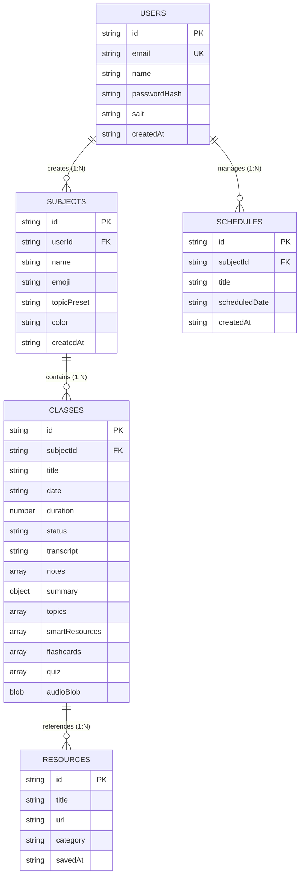

# Entity Relationship & Data Model — LectureAI

This document describes the IndexedDB data model and entity relationships implemented in **LectureAI**.

---

## 1. Entity Relationship (ER) Diagram

---

## 2. IndexedDB Object Stores Specification

Database Name: `voicenotes-ai` (Version `4`)

### 2.1 `users` Store
- **Primary Key**: `id` (string UUID)
- **Indices**: `email` (unique)
- **Attributes**:
  - `id`: Unique identifier
  - `email`: User email address
  - `name`: User full name
  - `passwordHash`: PBKDF2 hashed password string
  - `salt`: Base64 cryptographic salt
  - `createdAt`: ISO 8601 timestamp

### 2.2 `subjects` Store
- **Primary Key**: `id` (string UUID)
- **Indices**: `createdAt`, `userId`
- **Attributes**:
  - `id`: Unique identifier
  - `userId`: Foreign key linking to `users.id`
  - `name`: Subject title (e.g., "Data Structures")
  - `emoji`: Visual subject icon
  - `color`: Subject theme color code
  - `createdAt`: Creation timestamp

### 2.3 `classes` Store (Lectures)
- **Primary Key**: `id` (string UUID)
- **Indices**: `subjectId`, `date`
- **Attributes**:
  - `id`: Unique identifier
  - `subjectId`: Foreign key linking to `subjects.id`
  - `title`: Lecture title
  - `date`: Lecture execution date
  - `duration`: Session duration in seconds
  - `status`: Session lifecycle (`recording` | `paused` | `completed`)
  - `transcript`: Full recognized speech transcript text
  - `notes`: Array of note objects `[{ id, text, timestamp, highlights }]`
  - `summary`: Object containing AI overview and key takeaways
  - `topics`: Array of detected topics `[{ topic, subtopic, time }]`
  - `smartResources`: Array of recommended resource objects
  - `flashcards`: Array of generated flashcard objects `[{ id, question, answer }]`
  - `quiz`: Array of generated quiz objects `[{ id, question, options, correctIndex }]`
  - `audioBlob`: Binary audio recording data (`audio/webm`)

### 2.4 `schedules` Store
- **Primary Key**: `id` (string UUID)
- **Indices**: `scheduledDate`
- **Attributes**:
  - `id`: Unique identifier
  - `subjectId`: Foreign key linking to `subjects.id`
  - `title`: Planned session title
  - `scheduledDate`: ISO 8601 target execution timestamp
  - `createdAt`: Record creation timestamp

### 2.5 `resources` Store
- **Primary Key**: `id` (string UUID)
- **Attributes**:
  - `id`: Unique identifier
  - `title`: Resource article or tutorial name
  - `url`: External target URL link
  - `savedAt`: ISO 8601 bookmark timestamp
