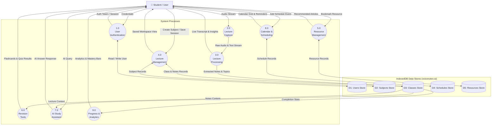

# Data Flow Diagrams (DFD) — LectureAI

This document presents the Data Flow Diagrams (DFD Level 0 and Level 1) for the **LectureAI** platform.

---

## 1. DFD Level 0 — Context Diagram

The Context Diagram defines the system boundaries of **LectureAI**, illustrating interactions between the external entity (**Student / User**) and the main application process.

```mermaid
flowchart TD
    Student["👤 Student / User"]
    
    subgraph SystemBoundary["LectureAI System Boundary"]
        LectureAISystem(("0.0\nLectureAI\nSystem"))
    end
    
    %% Inputs from Student
    Student -->|1. Credentials / Login Info| LectureAISystem
    Student -->|2. Live Microphone Audio| LectureAISystem
    Student -->|3. Manual Notes & Highlights| LectureAISystem
    Student -->|4. Search Queries| LectureAISystem
    Student -->|5. AI Questions & Prompts| LectureAISystem
    Student -->|6. Calendar Schedules| LectureAISystem
    Student -->|7. Saved Resources & Bookmarks| LectureAISystem
    
    %% Outputs to Student
    LectureAISystem -->|A. Dashboard & Statistics| Student
    LectureAISystem -->|B. Real-Time Speech Transcript| Student
    LectureAISystem -->|C. Structured Notes & Key Takeaways| Student
    LectureAISystem -->|D. Detected Topics & Insights| Student
    LectureAISystem -->|E. Curated Study Resources| Student
    LectureAISystem -->|F. Interactive Flashcards & Quizzes| Student
    LectureAISystem -->|G. AI Q&A Responses| Student
    LectureAISystem -->|H. Academic Calendar & Notifications| Student
```

---

## 2. DFD Level 1 — Process Diagram

DFD Level 1 decomposes the system into main functional processes and their data interactions with IndexedDB data stores (`D1`–`D5`).

