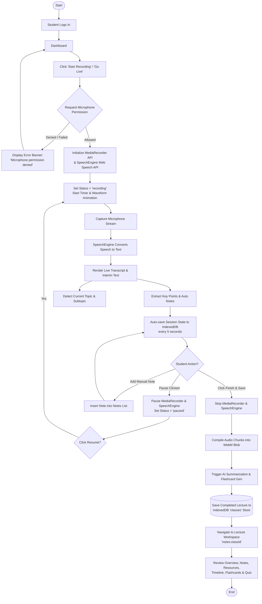
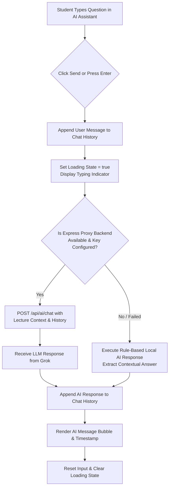

# Lecture Workflow & AI Resource Flow — LectureAI

This document details the detailed flowcharts for the core **Live Lecture Recording Workflow** and the **AI Topic & Resource Recommendation Engine** in **LectureAI**.

---

## 1. Core Lecture Recording & Save Flowchart



---

## 2. AI Topic Detection & Resource Flowchart

```mermaid
flowchart TD
    TranscriptIn[Live Speech Transcript Input] --> Tokenizer[Extract Recent Text Segment\n(Last 2000 Characters)]
    
    Tokenizer --> KeywordMatch{Match TOPIC_KEYWORDS\n(CNN, Pooling, Trees, DBMS, OS)}
    
    KeywordMatch -->|Matches >= 2 Keywords| TopicFound[Update Current Topic &\nSubtopic State]
    KeywordMatch -->|Matches < 2 Keywords| GeneralTopic[Default to 'General Discussion']
    
    TopicFound --> TriggerUI[Display Topic Change Toast Notification]
    GeneralTopic --> ConceptsFetch
    
    TriggerUI --> ConceptsFetch[Fetch Related Concepts & Smart Resources]
    
    ConceptsFetch --> RenderInsights[Render Live Insights Panel:\nTopic Name, 92% Confidence, Key Points]
    
    RenderInsights --> StudentInteract{Student Clicks Resource?}
    
    StudentInteract -->|Open Resource| OpenURL[Open Target External Link\nin New Tab]
    StudentInteract -->|Bookmark Resource| SaveResource[(Save Resource Record to\nIndexedDB 'resources' Store)]
```

---

## 3. AI Assistant Q&A Flowchart


