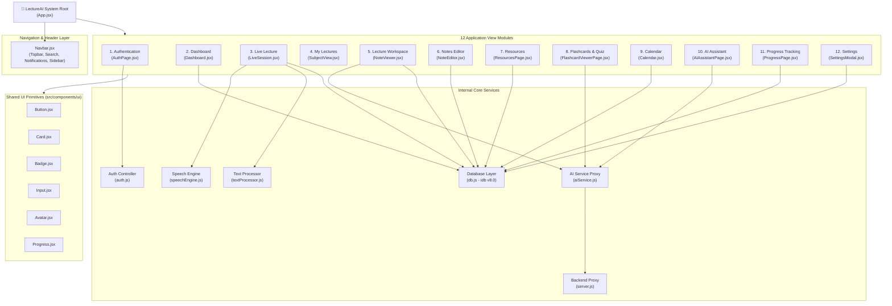

# Module Hierarchy & Component Architecture — LectureAI

This document details the software module hierarchy and component structural layout of the **LectureAI** platform.

---

## 1. System Module Hierarchy Diagram

---

## 2. Module Functional Breakdown

| Module | Primary Component | Responsibility & Interactions |
| :--- | :--- | :--- |
| **Authentication** | `AuthPage.jsx` | Renders login/signup form with password eye toggle, hero step-flow cards, and social proof reviews. Interacts with `auth.js` and IndexedDB `users` store. |
| **Dashboard** | `Dashboard.jsx` | Renders user greeting, 4 stats cards, Continue Learning widget, Upcoming Schedule list, AI Insights grid, Live Lecture Insights right panel, and Study Progress donut chart. |
| **Live Lecture** | `LiveSession.jsx` | Manages active recording sessions. Displays waveform, live transcript, interim text, auto/manual notes, and AI topic confidence meter. Interacts with `speechEngine.js` and `MediaRecorder`. |
| **My Lectures** | `SubjectView.jsx` | Displays subject header banner and lists all recorded class sessions for a selected subject with fallback demo items. |
| **Lecture Workspace** | `NoteViewer.jsx` | Post-lecture review hub with 10 workspace tabs (`Overview`, `Notes`, `Resources`, `Concept Map`, `Important`, `Ask AI`, `Timeline`, `What I Missed`, `Flashcards`, `3D View`) and audio player bar. |
| **Notes Editor** | `NoteEditor.jsx` | Rich note editor supporting text modifications, point creation, deletion, text highlighting, and auto-saving. |
| **Resources** | `ResourcesPage.jsx` | Filterable academic resource grid with external link triggers and IndexedDB bookmarking via `saveResource`. |
| **Flashcards & Quizzes** | `FlashcardViewerPage.jsx` | Render wrapper for `FlashcardViewer.jsx`. Manages 3D card flips, next/prev navigation, quiz option selection, score calculation, and progress fills. |
| **Calendar** | `Calendar.jsx` | Monthly academic planner grid for date selection, schedule creation, and IndexedDB `schedules` storage. |
| **AI Assistant** | `AIAssistantPage.jsx` | Chatbot Q&A interface with suggestion chips, typing indicator, and `askAI` proxy execution. |
| **Progress Tracking** | `ProgressPage.jsx` | Analytics view presenting completion counts, study hours, quiz accuracy rates, and topic mastery progress bars. |
| **Settings** | `SettingsModal.jsx` | Modal dialog for selecting AI model (`GPT-4o`, `Gemini 1.5 Pro`), testing API connectivity, and managing preferences. |
