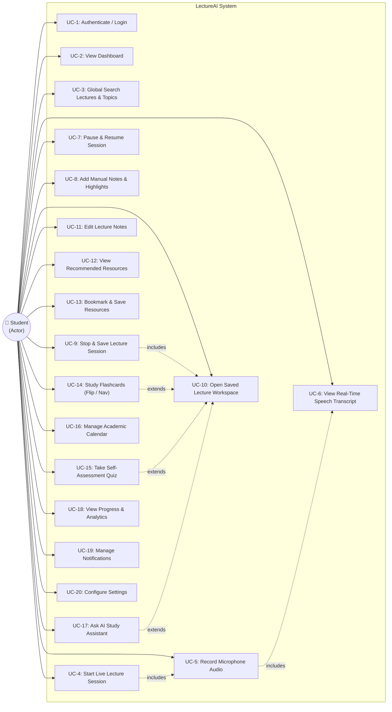

# Use Case Specifications & Diagram — LectureAI

This document presents the Use Case Diagram and action specifications for the **LectureAI** platform.

---

## 1. Use Case Diagram

---

## 2. Key Use Case Descriptions

### UC-4: Start Live Lecture Session
- **Primary Actor**: Student
- **Preconditions**: User is logged in and located on Dashboard or Subject view.
- **Main Success Scenario**:
  1. Student clicks **Go Live** or **Start Recording**.
  2. Browser prompts for microphone permission.
  3. System initializes `MediaRecorder` audio capture and `SpeechEngine` speech recognition.
  4. Interface displays recording timer, live waveform, and active transcript pane.

### UC-9: Stop & Save Lecture Session
- **Primary Actor**: Student
- **Preconditions**: Live recording session is in progress or paused.
- **Main Success Scenario**:
  1. Student clicks **Finish & Save**.
  2. System terminates audio recording and speech engine streams.
  3. System triggers automated AI summarization of transcript and extracted notes.
  4. System persists lecture record (with audio blob, summary, and flashcards) to IndexedDB `classes` store.
  5. System redirects student to the saved Lecture Workspace view (`notes:id`).

### UC-14: Study Flashcards
- **Primary Actor**: Student
- **Preconditions**: Lecture workspace or Flashcards module is active.
- **Main Success Scenario**:
  1. Student selects **Flashcards** view.
  2. System loads flashcard deck generated from lecture notes.
  3. Student flips cards by clicking or pressing `Space`, and navigates using `Left`/`Right` arrow keys.
